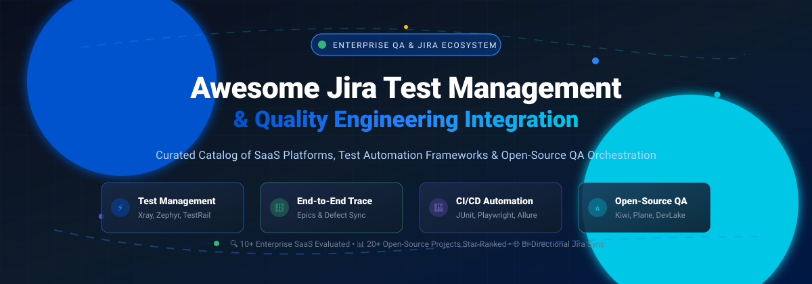

<div align="center">

<p align="center">
  
</p>

# 🚀 Awesome Jira Test Management Integration Ecosystem

<a href="https://github.com/ishandutta2007/Awesome-Awesome-Awesome"></a><a href="https://discord.gg/jc4xtF58Ve"></a>
[](LICENSE)
[](https://github.com/ishandutta2007/Awesome-JIRA-Test-Management-Integration/pulls)
[](https://github.com/ishandutta2007/Awesome-JIRA-Test-Management-Integration)
[](https://github.com/ishandutta2007/Awesome-JIRA-Test-Management-Integration)
<a href="https://github.com/ishandutta2007"></a>

<p align="center">
  <strong>Curated Directory of Top SaaS Platforms & Open-Source Projects for Jira Quality Assurance, Test Case Management, Traceability Matrices, and Automated CI/CD Defect Synchronization.</strong>
</p>

<p align="center">
  <a href="#-sector-overview--market-dynamics">Sector Overview</a> •
  <a href="#-saashosted-platforms">SaaS Platforms</a> •
  <a href="#-open-source-github-projects">Open-Source Projects</a> •
  <a href="#-enterprise-selection-matrix-choosing-the-right-solution">Comparison Matrix</a> •
  <a href="#-star-history">Star History</a> •
  <a href="#-support--sponsorship">Support</a> •
  <a href="#-how-to-contribute">Contributing</a>
</p>

</div>

---

## 📌 Executive Summary

Modern Agile and DevOps organizations require seamless synergy between product requirement tracking and quality assurance engineering. This comprehensive repository indexes the **Jira Test Management Integration Ecosystem**, cataloging enterprise **SaaS products** alongside **self-hosted open-source testing solutions**. 

Whether you need Jira-native apps (Xray, Zephyr Scale), standalone test management suites with bidirectional defect syncing (TestRail, Testmo, Qase), or community-driven frameworks (Kiwi TCMS, ReportPortal, Plane, DevLake), this guide delivers accurate pricing tiers, valuation benchmarks, and star-ranked open-source alternatives.

---

## 📊 Sector Overview & Market Dynamics

> The global **software testing and quality engineering market** is valued at approximately **$54 Billion to $58 Billion**, projected to surpass **$100 Billion** over the next decade at a robust CAGR of 11%–14%, with the dedicated **Test Management Software** segment accounting for over **$1 Billion** in software spend.
>
> **Market Concentration**: The sector is **moderately fragmented**. Rather than a single winner-take-all monopoly, the space is balanced between large corporate software conglomerates (Tricentis, SmartBear, Idera, BrowserStack) commanding substantial enterprise portfolios and nimble, modern challengers (Qase, Testmo, PractiTest) offering developer-friendly APIs, AI test assistance, and lightweight workflows.

---

## 💼 SaaS/Hosted Platforms

The table below presents leading SaaS and Atlassian Marketplace test management solutions. Sorted in **descending order by company scale** (estimated corporate valuation / annual recurring revenue).

| 🏢 Product & Platform | 💰 Pricing (Starting Tier) | 🎁 Free Tier Limits / Free Trial | 📈 Company Scale (Valuation / Revenue) | 🔍 Key Capabilities & Jira Synergy |
| :--- | :--- | :--- | :--- | :--- |
| **[Tricentis](https://tricentis.com)** *(qTest / Enterprise Testing)* | **$80.00** / user / month (approx. starting for qTest Cloud) | **14-day free trial**; full enterprise module access without credit card | **Valuation: ~$4.5 Billion** (GTCR-backed)<br>• ARR: ~$500M+ | Deep two-way synchronization with Jira epics, automated defect submission, enterprise test execution orchestration, and audit-ready compliance reporting. |
| **[BrowserStack Test Management](https://browserstack.com)** | **$149.00** / month (Team 5-user pack; ~$30/user/month) | **Permanent Free Forever Plan**: up to **5 users**, unlimited test cases & runs, 10 GB storage, 30-day run history | **Valuation: $4.0 Billion** (Bond Capital)<br>• ARR: ~$230M+ | Centralized dashboard linking test plans directly to Jira issues, automated defect logging with 1-click evidence capture, and tight real-device cloud pairing. |
| **[Zephyr Scale](https://smartbear.com)** *(SmartBear)* | **$10.00** / month flat (small team base; scales to ~$6.81/user/mo) | **30-day free trial** via Atlassian Marketplace; matches Jira Cloud instance user tier | **Valuation: ~$3.0 Billion** (Vista & Francisco Partners)<br>• Revenue: ~$150M–$200M+ | Native Jira app with nested test folders, reusable test libraries, native Gherkin/BDD editor, cross-project traceability, and REST API test injectors. |
| **[Xray Test Management](https://getxray.app)** *(Idera / Sembi)* | **$10.00** / month flat (up to 10 users; volume tiers above) | **30-day free trial** on Atlassian Marketplace; no permanent free tier (requires paid tier matching Jira user count) | **Parent Valuation: ~$3.0 Billion** (Idera / Partners Group)<br>• Parent Rev: $300M+ | Jira-native issue types for Tests, Preconditions, Test Plans, and Test Executions. End-to-end requirement traceability matrices and Cucumber/JUnit import. |
| **[TestRail for Jira](https://testrail.com)** *(Idera / Sembi)* | **$22.00** / user / month (Essentials, billed annually) | **30-day free trial**; unrestricted feature trial (no credit card required; no permanent free plan) | **Parent Valuation: ~$3.0 Billion** (Idera Group)<br>• TestRail Rev: ~$10M+ | Standalone web test repository featuring dedicated Jira add-on to view test runs inside Jira stories, push bugs directly, and correlate milestones. |
| **[QMetry Test Management](https://qmetry.com)** *(SmartBear)* | **$3.50** / user / month (approximate cloud starting band) | **Free Forever** for teams up to **10 users** on Jira Cloud; or **30-day free trial** for larger tiers | **Acquired by SmartBear** (Dec 2024; formerly Goldman Sachs backed) | AI-powered test authoring, exploratory testing extension, automated BDD scenario sync, and cross-project quality analytics natively in Jira. |
| **[SpiraTest](https://inflectra.com)** *(Inflectra)* | **$43.33** / concurrent user / month (3-user pack starts at $130/mo) | **30-day free trial**; 100% unlocked feature set with no credit card required | **Revenue: ~$12M–$13M ARR** (Profitable, bootstrapped) | Unified test case management, requirements traceability matrix, and bidirectional Jira bug & issue synchronization engine. |
| **[Qase](https://qase.io)** | **$35.00** / user / month (Teams tier, billed annually) | **Permanent Free Forever Plan**: up to **4 users**, 2 projects, 500 MB storage, 30-day data retention | **Revenue: ~$5.0M ARR**<br>• VC Raised: ~$7.7M (Series A) | Modern cloud QA platform with fast test case authoring, two-way Jira issue linking, automated defect generation, and 30+ CI/CD framework integrations. |
| **[PractiTest](https://practitest.com)** | **$47.00** / user / month (Team tier, billed annually; 5-user minimum) | **14-day free trial**; full platform access without credit card | **Revenue: ~$2.1M ARR** (Privately held) | End-to-end test management suite featuring bi-directional real-time Jira field synchronization, hierarchical filter trees, and AI-driven duplicate detection. |
| **[Testmo](https://testmo.com)** | **$99.00** / month flat (Team plan, up to 10 users included) | **21-day free trial**; full access to manual, exploratory, and automated test modules | **Bootstrapped / High-Growth** (Independent profitable SaaS) | Next-generation unified testing platform integrating manual test runs, exploratory sessions, and CI automation results with bidirectional Jira issue workflows. |

---

## 🌟 Open-Source GitHub Projects

Open-source test management platforms, test reporting orchestrators, and developer toolkits sorted in **descending order by GitHub_Stars_Count**.

| 📦 Repository & Project | ⭐ GitHub_Stars (Live Badge) | 🎯 Category / Technology Stack | 📝 Description & Jira Traceability Synergy |
| :--- | :---: | :--- | :--- |
| **[n8n](https://github.com/n8n-io/n8n)** | [](https://github.com/n8n-io/n8n/stargazers) | Workflow Automation & Orchestration (Node.js/TypeScript) | Self-hostable workflow automation engine with native Jira nodes to auto-generate Jira bugs from CI/CD test suite failures and dispatch QA webhooks. |
| **[Plane](https://github.com/makeplane/plane)** | [](https://github.com/makeplane/plane/stargazers) | Agile Project & Issue Management (Python/TypeScript) | Modern open-source Jira and Linear alternative with rich issue lifecycles, Kanban/cycles tracking, and integration hooks for QA test suites. |
| **[OpenProject](https://github.com/opf/openproject)** | [](https://github.com/opf/openproject/stargazers) | Project & Defect Management (Ruby on Rails/Angular) | Enterprise open-source management platform with bug tracking, requirement traceability, and comprehensive REST APIs for test management pipelines. |
| **[Robot Framework](https://github.com/robotframework/robotframework)** | [](https://github.com/robotframework/robotframework/stargazers) | Acceptance Test Automation & RPA (Python) | Generic keyword-driven automation framework with numerous open-source Jira/Xray/Zephyr plugins to push execution statuses into Jira. |
| **[Jira CLI](https://github.com/ankitpokhrel/jira-cli)** | [](https://github.com/ankitpokhrel/jira-cli/stargazers) | Developer CLI Tooling (Go) | Interactive command-line client for Jira used in continuous integration pipelines to file bug tickets, link test failures, and transition issue states. |
| **[Allure Report (Allure 2)](https://github.com/allure-framework/allure2)** | [](https://github.com/allure-framework/allure2/stargazers) | Test Execution Reporting (Java/JavaScript) | Multi-language test reporting framework supporting `@Issue`, `@TmsLink`, and Jira issue navigation from JUnit, PyTest, TestNG, Playwright, and Cypress. |
| **[DefectDojo](https://github.com/DefectDojo/django-DefectDojo)** | [](https://github.com/DefectDojo/django-DefectDojo/stargazers) | DevSecOps & Security QA Management (Python/Django) | Open-source vulnerability and security test management tool with bi-directional Jira synchronization for automated defect tracking. |
| **[Apache DevLake](https://github.com/apache/devlake)** | [](https://github.com/apache/devlake/stargazers) | Engineering Analytics Platform (Go) | Ingests data from Jira, GitHub, and Jenkins to compute QA engineering metrics such as defect escape rates, bug resolution velocity, and test coverage. |
| **[Cucumber JVM](https://github.com/cucumber/cucumber-jvm)** | [](https://github.com/cucumber/cucumber-jvm/stargazers) | BDD Specification & Testing (Java) | Standard Gherkin BDD testing engine paired with Jira plugins (Xray, Zephyr, Kiwi) to sync user stories directly to automated step definitions. |
| **[Gauge](https://github.com/getgauge/gauge)** | [](https://github.com/getgauge/gauge/stargazers) | Lightweight Acceptance Testing (Go/Multi-lang) | ThoughtWorks-backed markdown-based acceptance testing framework easily tied to Jira issue keys and CI quality gates. |
| **[Selenoid](https://github.com/aerokube/selenoid)** | [](https://github.com/aerokube/selenoid/stargazers) | Test Infrastructure & Grid (Go) | Lightweight containerized implementation of Selenium/Playwright browser execution with video logs attachable to Jira bug filings. |
| **[Zalenium](https://github.com/zalando/zalenium)** | [](https://github.com/zalando/zalenium/stargazers) | Scalable Docker Selenium Grid (Java) | Scalable on-demand Docker test execution grid featuring dashboard recording and direct bug issue attachments. |
| **[pycontribs/jira](https://github.com/pycontribs/jira)** | [](https://github.com/pycontribs/jira/stargazers) | Jira API SDK (Python) | Standard Python SDK for automating Jira interactions, programmatic test ticket updates, issue linking, and bulk defect syncing. |
| **[ReportPortal](https://github.com/reportportal/reportportal)** | [](https://github.com/reportportal/reportportal/stargazers) | AI-Powered Centralized Reporting (Java/React) | Enterprise test automation dashboard with native Jira Bug Tracking System integration to log defect tickets directly from failed automated assertions. |
| **[atlassian-python-api](https://github.com/atlassian-api/atlassian-python-api)** | [](https://github.com/atlassian-api/atlassian-python-api/stargazers) | Jira REST Automation Library (Python) | Comprehensive Python wrapper for Jira Cloud/Server, Confluence, and Xray APIs, making automated QA result push scripts frictionless. |
| **[TestLink](https://github.com/TestLinkOpenSourceTRMS/testlink-code)** | [](https://github.com/TestLinkOpenSourceTRMS/testlink-code/stargazers) | Test Case Management System (PHP) | Battle-tested open-source test management platform featuring Jira SOAP/REST bug-tracking plugins, test suites, execution milestones, and metric graphs. |
| **[Docker Redmine](https://github.com/sameersbn/docker-redmine)** | [](https://github.com/sameersbn/docker-redmine/stargazers) | Issue & Test Tracking Container (Docker/Ruby) | Production-ready Docker container for Redmine; commonly paired with Redcase or TestLink plugins for integrated requirement-to-defect QA tracking. |
| **[Kiwi TCMS](https://github.com/kiwitcms/kiwitcms)** | [](https://github.com/kiwitcms/kiwitcms/stargazers) | Dedicated Open-Source TCMS (Python/Django) | Leading active open-source test management suite with native Jira bug tracker integration, execution plans, automated CI importers, and REST API plugins. |
| **[Carina](https://github.com/zebrunner/carina)** | [](https://github.com/zebrunner/carina/stargazers) | Test Automation Framework (Java) | Zebrunner-backed open-source mobile/web test framework with native Jira issue tags and deep automated failure analytics reporting. |
| **[Allure Python](https://github.com/allure-framework/allure-python)** | [](https://github.com/allure-framework/allure-python/stargazers) | Test Reporting Adapters (Python) | Integrations for PyTest, Behave, and Robot Framework mapping test assertions to Jira issues via `@allure.issue` decorators. |
| **[Serenity BDD](https://github.com/serenity-bdd/serenity-core)** | [](https://github.com/serenity-bdd/serenity-core/stargazers) | Living Documentation & Acceptance QA (Java) | Living documentation framework that links automated acceptance tests directly to Jira user stories and epics via `@issue` annotations. |
| **[Allure Docker Service](https://github.com/fescobar/allure-docker-service)** | [](https://github.com/fescobar/allure-docker-service/stargazers) | Centralized Historical Reporting (Docker) | Containerized service for continuous generation and hosting of Allure reports with clickable Jira requirement and defect links. |
| **[Nitrate](https://github.com/Nitrate/Nitrate)** | [](https://github.com/Nitrate/Nitrate/stargazers) | Enterprise Test Case Management (Python/Django) | Scalable test plan and test run management system originally engineered for Linux distribution QA, featuring external bug-tracker sync. |
| **[Gherkin Lint](https://github.com/gherkin-lint/gherkin-lint)** | [](https://github.com/gherkin-lint/gherkin-lint/stargazers) | BDD Specification Linter (JavaScript) | Linter for `.feature` Gherkin files ensuring structured scenario consistency before syncing with Jira test management plugins. |
| **[Jenkins Jira Plugin](https://github.com/jenkinsci/jira-plugin)** | [](https://github.com/jenkinsci/jira-plugin/stargazers) | CI/CD Integration Plugin (Java) | Connects Jenkins build results and test reports directly to Jira issues, recording test phase completions into deployment releases. |
| **[Tarantula](https://github.com/prove/tarantula)** | [](https://github.com/prove/tarantula/stargazers) | Agile Test Management (Ruby on Rails) | Lightweight agile test management tool designed for structured test runs, exploratory QA notes, and issue tracker bug logging. |
| **[CTRF](https://github.com/ctrf-io/ctrf)** | [](https://github.com/ctrf-io/ctrf/stargazers) | Universal Test Report Standard (JSON/Schema) | Common Test Report Format and multi-framework CI reporters standardizing test output for ingestion into Jira dashboards and test suites. |

---

## 🎯 Enterprise Selection Matrix: Choosing the Right Solution

```
                                  Do you require a Native Jira App?
                                              /          \
                                            YES           NO
                                           /                \
                     Does your entire Jira seat count      Need an independent, dedicated
                     dictate your testing budget?          QA hub with its own user seats?
                                   /      \                              /          \
                                 YES       NO                          YES           NO
                                 /          \                          /              \
                     [Xray / Zephyr Scale]   [BrowserStack / Qase]  [Testmo / TestRail]  [Kiwi TCMS / Plane]
                     (Deep Atlassian          (Pay only for QA      (Full QA lifecycle   (Self-hosted, zero
                      integration)             testers)              dashboards)          license fees)
```

1. **Jira-Native Apps (Xray, Zephyr Scale, QMetry)**: Best when software developers, product managers, and QA teams live exclusively inside Jira Cloud/Data Center and want test cases treated as first-class native Jira issue types.
2. **Hybrid / Specialized SaaS (BrowserStack, Testmo, Qase, TestRail, PractiTest)**: Optimal when you have a dedicated QA department that needs high-performance test design, exploratory testing sessions, and multi-framework automation reporting without licensing all general Jira users.
3. **Open-Source Self-Hosted (Kiwi TCMS, ReportPortal, Allure, Plane)**: Ideal for engineering organizations requiring strict on-premise data governance, compliance mandates, zero licensing fees, and full control over their QA storage pipeline.

---

## 📈 Star History

[](https://www.star-history.com/#ishandutta2007/Awesome-JIRA-Test-Management-Integration&type=date&legend=top-left)

---

## 💖 Support & Sponsorship

If this curated ecosystem guide helps your team streamline test management, requirements traceability, and Jira CI/CD workflows, please consider showing your support:

- ⭐ **Star this repository** to help others discover quality engineering resources.
- 🍴 **Fork the project** and contribute additions or updates.
- 📢 **Share with fellow SDETs**, QA managers, and DevOps engineers on LinkedIn, Reddit, or Discord.
- ☕ **Support continuous maintenance & updates**:

<p align="left">
  <a href="https://github.com/sponsors/ishandutta2007">
    
  </a>
</p>

---

## 🤝 How to Contribute

Contributions are welcome! Please read the contribution guidelines below before submitting a pull request:

1. **Fork the repository** to your personal GitHub account.
2. **Review formatting conventions**:
   - For **SaaS Platforms**: Include exact starting tier pricing, specific free trial / free plan limits, verified valuation/revenue scale, and a functional link.
   - For **Open-Source Projects**: Include the live social-style Stars_Badge linked to the repo's stargazers page (`https://github.com/owner/repo/stargazers`), technology stack, and a clear description highlighting Jira integration.
3. **Commit your changes**: Ensure commit messages are descriptive (e.g., `feat: add new open-source test reporter`).
4. **Submit a Pull Request**: Provide a concise summary of the added tool and verify that all links are active and accurate.

---

## 📄 License & Disclaimer

- Distributed under the [MIT License](LICENSE).
- All brand names, product logos, and registered trademarks mentioned are property of their respective owners (Atlassian, BrowserStack, SmartBear, Idera, Tricentis, Inflectra, Qase, Testmo, etc.).
- Independent curated list intended for informational and educational evaluation purposes.
